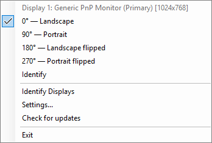
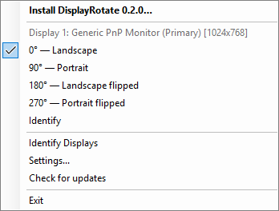
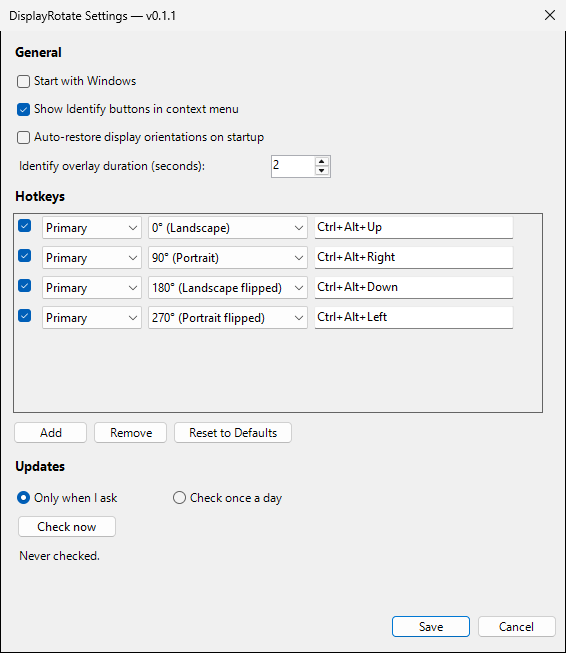
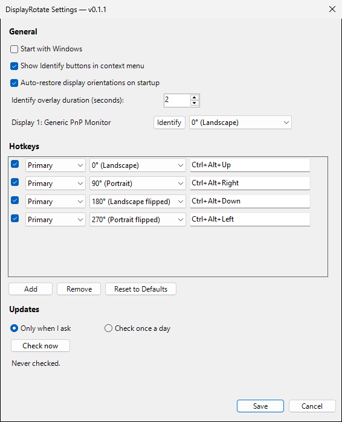
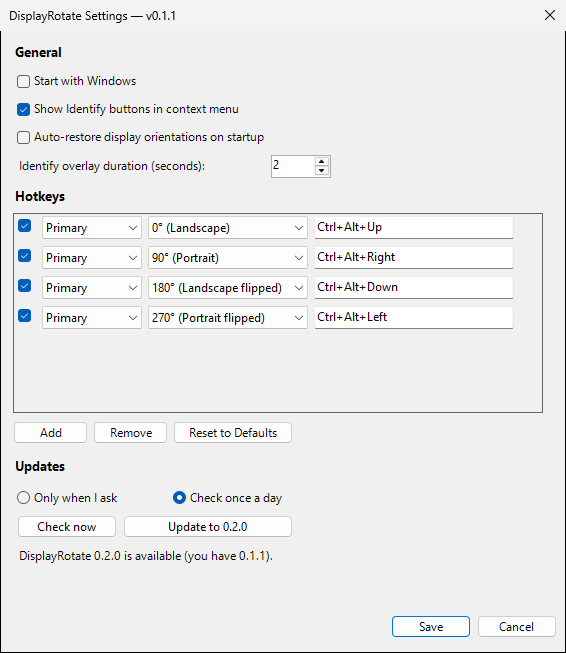

# Screenshots

Every window DisplayRotate shows, made by the docs tour (`tests/DisplayRotate.DocsTests`). The
README's [Screenshots](../../README.md#screenshots) section says how to make them again.

## Tray menu

Click the tray icon, left or right. Each display is listed with its resolution and its four
orientations, and the current one is ticked. Below them are **Identify Displays**,
**Settings...**, **Check for updates** and **Exit**.

## Tray menu with an update

Once a check has found a newer release, **Install DisplayRotate X.Y.Z…** heads the menu.

## Settings

**Settings...** in the tray menu: general options, the hotkeys (click a hotkey's box and press
the new combination), and the update choice. **Save** keeps the changes to the options and
hotkeys, **Cancel** drops them.

## Settings with auto-restore

With **Auto-restore display orientations on startup** ticked, each display gets a row: its name,
an **Identify** button, and the orientation DisplayRotate puts back every time it starts.

## Settings with an update

After **Check now** has found a newer release, **Update to X.Y.Z** downloads, verifies and
installs it ([docs/updating.md](../updating.md)). A portable copy shows **Open download page**
instead.

## Identify overlay

**Identify** (one display) or **Identify Displays** (all of them) covers the screen with a
75%-opaque black layer showing the display's number, for the time set in Settings. A click or a
key closes it early. The picture shows the overlay without the desktop behind it.

